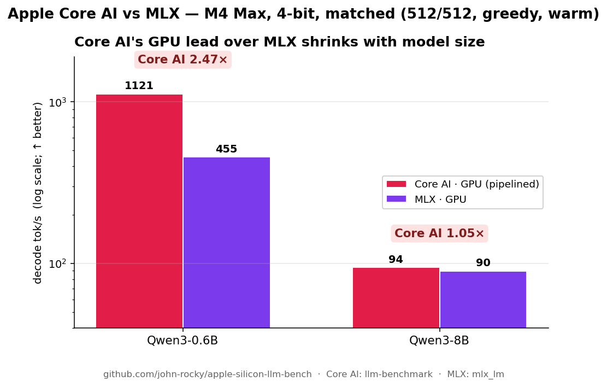

# Apple Core AI results

Core AI is Apple's on-device ML runtime in iOS 27 / macOS 27 and the successor to Core ML: PyTorch models are exported with Apple's `coreai-torch` (LLMs: `coreai.llm.export`) into `.aimodel` bundles that run on the GPU or the Neural Engine, e.g. Qwen3-8B 4-bit decodes at 94 tok/s on an M4 Max GPU, MLX 90 under the same protocol ([apple-silicon-llm-bench](https://github.com/john-rocky/apple-silicon-llm-bench), macOS 27 beta, 2026-06).

[Core AI](https://developer.apple.com/documentation/coreai) is Apple's Core ML successor, announced at WWDC 2026 (iOS / macOS 27). First independent on-device LLM benchmark — vs MLX and CoreML, **same model, same harness**.

**iPhone 17 Pro · Qwen3-0.6B · short-chat · decode tok/s (cold = fresh-process first generation; warm = in-process median of runs 2-4, [fairness-rules §2](../methodology/fairness-rules.md)):**

| Engine | Compute | Cold | Warm (r2-4) | Peak RAM | Session |
|---|---|---:|---:|---:|---|
| **Core AI** (pipelined) | GPU | **193.3** 🏆 _(first-ever 76.5)_ | blocked† | 196 MB | 2026-06-18 |
| MLX | GPU | 167.2 | **158.8** | 489 MB | 2026-07-13 |
| **Core AI** (static-shape) | ANE | 143.7 | blocked† | 1,158 MB | 2026-06-18 |
| LiteRT-LM | GPU | 121.0 | 120.4 | 1,384 MB | 2026-07-13 |
| **CoreML-LLM** | ANE | 37.7 | pending‡ | **184** 🏆 | 2026-06-17 |

> **Read the Session column before comparing rows.** Cross-session ratios are invalid on this
> device: the same MLX binary and versions measured 126–133 tok/s in mid-June and 159–180 today
> (device-state change, likely an iOS 27 beta update — full investigation with raw data:
> [`results/raw/2026-07-13-mlx-variance/`](../results/raw/2026-07-13-mlx-variance/README.md)).
> Within-June sessions Core AI GPU led MLX (193.3 vs 126–133 cold ≈ **1.5×**); today's
> same-session Release warm gives **LiteRT-LM ≈ 0.76× MLX**. This replaces the earlier
> Debug-contaminated MLX 112 row and the "~1.6× once warm" framing.
>
> † **Core AI warm re-capture was blocked in July**: `coreai-build` aborted on the macOS 27
> beta of the time (both toolchain generations), so the 0.6B bundles could not be re-assembled —
> [`methodology/coreai-build-regression-2026-07.md`](../methodology/coreai-build-regression-2026-07.md);
> cold/warm behaviour was re-verified at 4B instead (bundles survive on-device). A warm capture
> of the macOS-26-era GPU bundle exists from 2026-08-26
> ([`results/raw/2026-08-26-iphone-coreai-pairs/`](../results/raw/2026-08-26-iphone-coreai-pairs/summary.md):
> 152.3 cold / 147.4 warm, engine 0.2.0+static-inputs-patch), but every number of that session
> started thermal-fair, so it fails the §2 guard and is not in the tables.
> ‡ CoreML-LLM stateful-chunks bundle needs re-conversion before it can be re-measured.
> The **184 MB** Core ML number has no per-run record in this repo: the three Core ML short-chat
> records (`results/raw/iphone17pro-coreml-llm-qwen3-0.6b-short-chat-run{1,2,3}.jsonl`) carry
> `memoryPeakDuringDecodeMB` 983–987, a different instrument from the figure quoted here — treat
> 184 MB as unverified until it is re-captured with the harness (stored-report-rule). The ANE 143.7
> row's record is `results/raw/superseded/2026-07-14-iphone-final/` (run 3 of the June session),
> superseded by the 2026-07-13 re-capture (118.7 cold / 116.9 warm, LEADERBOARD.md).

- **Core AI's GPU "pipelined" engine was the fastest path in the June session** — cold 193.3
  after a one-time first-ever cost (76.5 on the very first generation while the shader/pipeline
  caches build; subsequent fresh processes hit ~194). MLX and LiteRT are flat cold-to-warm.
- **Core AI's compute unit is fixed by the *export shape*, not a runtime flag:** `coreai.llm.export … --platform iOS` (static) is detected as chunked-static → the **ANE**; a dynamic export → the **GPU** pipelined engine. And iOS can't JIT the exported IR — it must be `coreai-build compile`-d to a per-GPU-arch `.aimodelc` first (`No such file or directory` otherwise).
- **CoreML-LLM is the memory champion** — 184 MB, ~6× leaner than Core AI's ANE path — via a stateful INT4 Neural-Engine conversion (own work, 100% ANE residency).
- Faithful to Apple's intended path: official `coreai.llm.export` + the `coreai-models` `CoreAILM` runtime, driven by the in-tree [`CoreAIRuntime`](../ios/BenchmarkApp/Sources/Runtimes/CoreAIRuntime.swift). Method + gotchas: [`methodology/coreai-ios.md`](../methodology/coreai-ios.md).

**Does the GPU lead hold at scale? (Mac M4 Max, same params)**

| Model (4-bit) | Core AI GPU | MLX | Core AI lead |
|---|---:|---:|---:|
| Qwen3-0.6B (macOS-26 export) | 1,121 | 455 | **2.47×** |
| Qwen3-0.6B (macOS-27β re-export) | ~500 | 455 | **1.1×** |
| Qwen3-8B | 94 | 90 | **1.05×** |

Core AI's pipelined-GPU lead is large on **tiny** models — where its async-dispatch / overlap dominates — but **converges to a near-tie at a realistic 8B**, where both runtimes become memory-bandwidth-bound. _(Matched: 512-token prompt, 512 gen, greedy, warm. Core AI via Apple's `llm-benchmark`; MLX via `mlx_lm`.)_

> ⚠️ **The 0.6B number is export-generation-dependent.** The same `coreai.llm.export`
> recipe produces a 2.2× slower artifact after the macOS 27 beta upgrade (native
> quantized-Linear lowering → explicit dequant ops; same runtime, same code, same
> wheels). Forensics: [`methodology/coreai-export-lowering.md`](../methodology/coreai-export-lowering.md).
> Benchmark the artifact you ship.
>
> **Confirmed on iPhone 17 Pro** (both artifacts AOT-compiled `--architecture h18p`,
> GPU, synthetic 512p/1024g — deeper-KV protocol, NOT comparable to the short-chat
> table above): macOS-26 artifact **115.1 tok/s** decode / 5,807 prefill / 0.22 GB
> footprint vs 27β artifact 57.2 / 1,519 / 0.47 GB — **~2× decode, 3.8× prefill,
> half the memory, from the export environment alone.** ANE (official iOS static
> preset, same protocol): 69.6 tok/s, 0.045 s warm load.

**Full official-recipe matrix (M4 Max, macOS 27β artifacts, `llm-benchmark` defaults 512p/1024g/5):**

| Model | Artifact | Core AI decode (prefill) | MLX 0.31.3 decode (prefill) | Decode verdict |
|---|---|---:|---:|---|
| gpt-oss-20b (MoE, MXFP4) | 13 GB | 78.1 (1,252) | **100.2** (1,528) | **MLX +28%** |
| qwen3-0.6b | 335 MB | **484** (9,396) | 432 (9,366) | **Core AI +12%** |
| qwen3-4b | 2.1 GB | 145.4 (**1,635**) | 145.8 (1,495) | tie |
| qwen3-8b | 4.3 GB | **94.1** (912) | 90.0 (825) | **Core AI +5%** |
| gemma3-4b-it | 2.1 GB | **141.5** (1,669) | 136.3 (1,631) | **Core AI +4%** |
| gemma3-12b-it | 6.2 GB | 55.0 (**578**) | 55.1 (528) | tie |
| mistral-7b-v0.3 | 3.8 GB | **101.7** (976) | 97.5 (918) | **Core AI +4%** |

**Core AI matches or beats MLX on every dense model; MLX's one clear win is the MoE**
(expert dispatch, not the core engine). On noise: per-trial σ is ≤0.4% on 6 of 7
models (worst 1.3%) — the dense deltas are 10–30× trial noise with a consistent
direction; cross-machine variance is what independent reproduction tests (welcome —
per-trial JSONs + environment versions in `results/raw/`). gpt-oss-20b bonus: `COREAI_CHUNK_THRESHOLD` is a
memory dial — unchunked 4096-token prefill hits 1,439 tok/s (+16%) at 18 GB dirty
footprint, chunk-128 (the `llm-runner` MoE hint) caps memory at 1.7 GB for 766 tok/s.
Raw logs + environment versions: [`results/raw/2026-06-11-m4max-coreai-matrix/`](../results/raw/2026-06-11-m4max-coreai-matrix/).
**Every bundle measured here is downloadable** (hashes + env stamps on the cards, incl.
the irreproducible macOS-26 0.6B artifact): [HF `<model>-CoreAI-official` repos](https://huggingface.co/mlboydaisuke).
