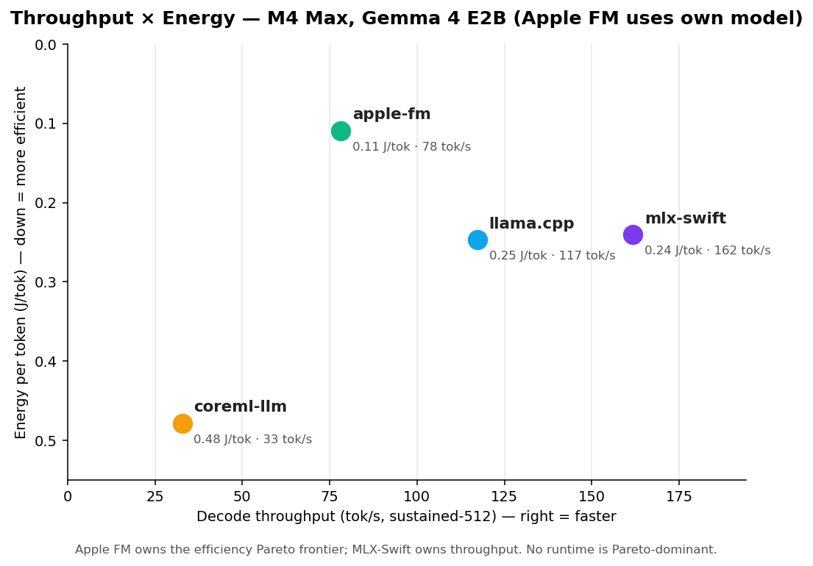
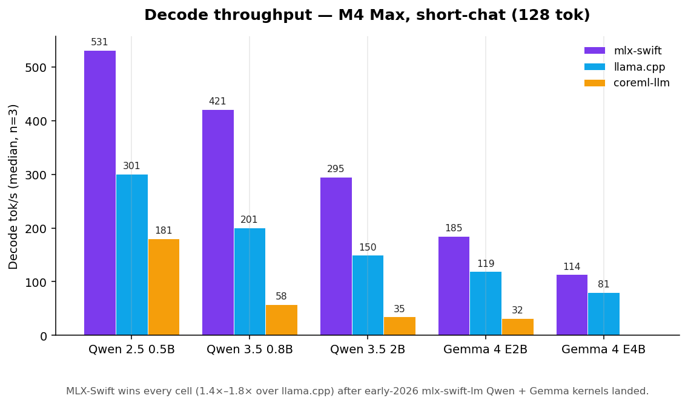
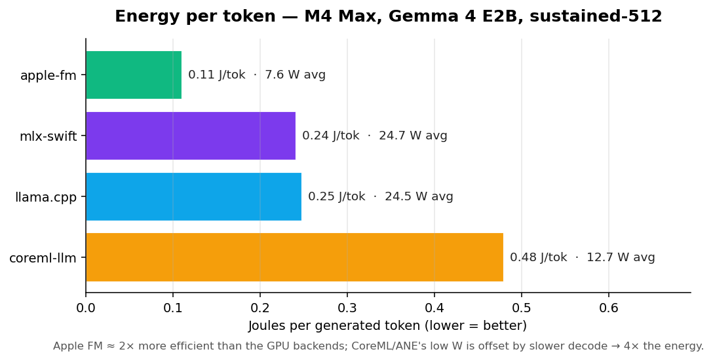
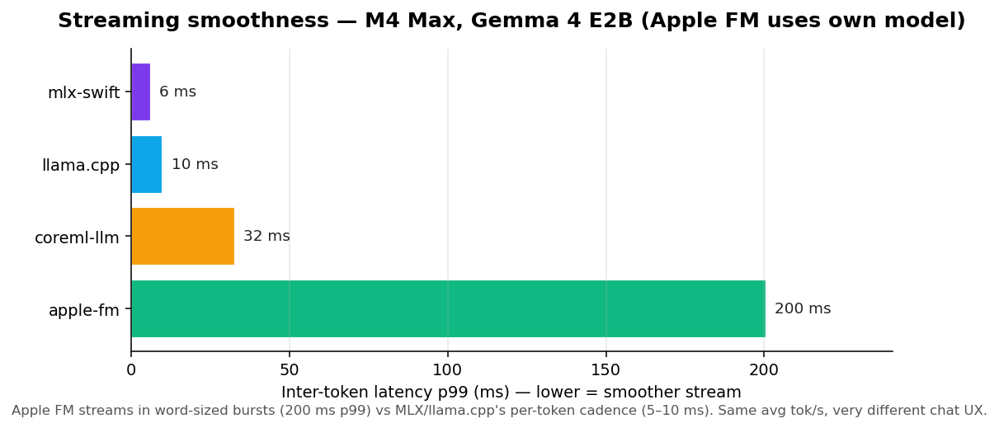
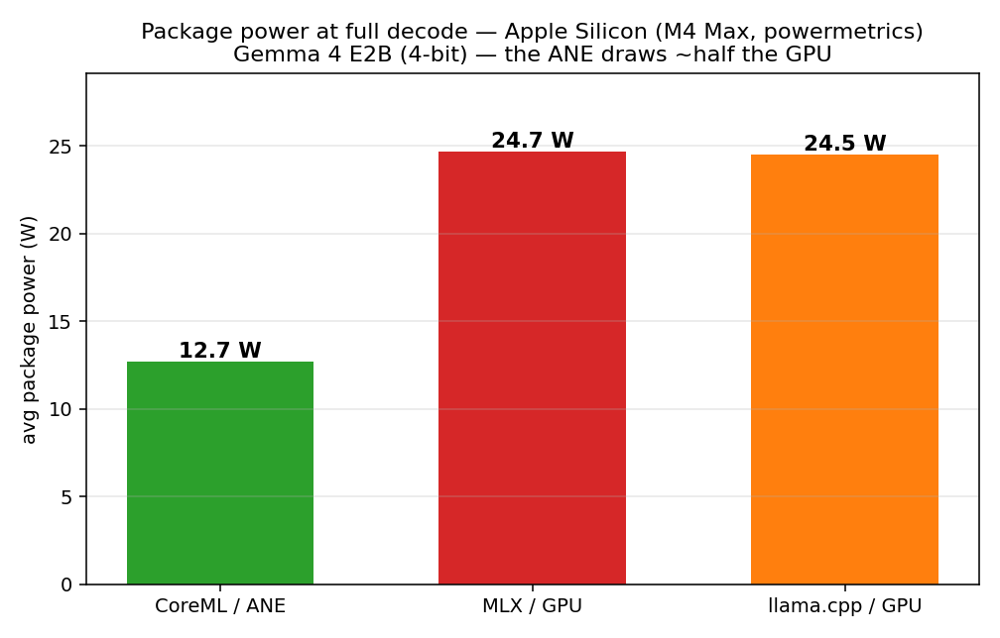

# Apple M4 Max results

The same harness on a laptop-class chip, for scale. No runtime wins everything here — each optimises a different corner of the throughput / memory / energy / streaming box.

**Gemma 4 E2B, best-available builds — throughput × energy (2026-07-19, decode-window J/token, warm loads):**

| Build | J/tok (decode) | W (decode) | tok/s |
|---|---:|---:|---:|
| 🟣 MLX PTQ 4-bit | **0.090** 🏆 | 14.6 | **177.8** 🏆 |
| 🟣 MLX QAT OptiQ | 0.106 | 14.6 | 149.5 |
| 🔴 LiteRT wNa8o8 *(WebGPU path)* | 0.154 | 22.2 | 155.0 |
| 🔵 llama.cpp Q4_K_M | 0.170 | 20.5 | 127.1 |
| 🍎 Core AI own int4 *(patched, S=1 window)* | ~0.33 | 18.9 | 53 eff. |

- **MLX owns the Mac energy Pareto** — fastest *and* most efficient, at the lowest package power. The +7-pt GSM8K of OptiQ costs +18 % J/tok.
- **The LiteRT row does not answer the int8-activation energy question**: Mac LiteRT runs the WebGPU→Metal path, a different efficiency class from the iPhone's native path (where wNa8o8 wins decode+memory). That question needs the iPhone battery-delta bench (planned as part 2).
- **Core AI pays its S=1 prefill wall in energy too** on the Mac (~2.2× MLX's J/tok at 0.3× the speed) — patched-engine reference row, whole-window measurement.
- Whole-system `powermetrics` on an idle desktop; decode-window attribution (the trailing generation phase of the sample train) so per-runtime load differences don't dilute the number. Raw rows: `results/raw/m4max-*-sustained-energy.jsonl`.

Older cross-runtime observations (Apple FM 2× efficiency, CoreML/ANE memory-vs-J/tok inversion) belong to the 4-backend charts below, measured 2026-05 with full-window attribution:

| | |
|---|---|
|  |  |
|  | _Tables for the exact numbers live below._ |

Regenerate after adding rows: `python scripts/generate_charts.py`.

## Full numbers: short-chat (128 tokens, decode tok/s, median)

> One device, four runtimes, multiple models. Decode tok/s is the primary headline number; the full table (prefill, TTFT, peak memory, per-run audit trail) lives in [`RESULTS.md`](../RESULTS.md). Read the [Headline observations](../RESULTS.md#headline-observations-read-this-after-the-tables) section before drawing conclusions — the runtime ranking is **model-size-dependent**.

### Cross-runtime — same logical model, different backends (decode tok/s, median)

| Logical model | Params | n | mlx-swift (Q4) | llama.cpp (Q4_K_M) | coreml-llm | litert-lm (.litertlm) |
|---|---:|---:|---:|---:|---:|---:|
| Qwen 2.5 0.5B | 0.5 B | 3 | **531.1** | 297.1 | 181.2 (FP16) | n/a |
| Qwen 3.5 0.8B | 0.8 B | 3 | **421.1** | 201.1 | 58.2 (INT8) | n/a |
| Qwen 3.5 2B   | 2 B   | 3 | **291.9** | 149.7 | 35.0 (INT8) | n/a |
| Gemma 4 E2B   | 2 B   | 3 | **185.4** | 119.2 | 32.5 (INT4 palettized) | _pending_ |
| Gemma 4 E4B   | 4 B   | 3 | **113.5** | 80.5 | _not run_ | _pending_ |

> `litert-lm` column: **_pending_** = no M4 Max run on `google-ai-edge/LiteRT-LM` v0.12.0 when this table was made. Later LiteRT-LM runs on the M4 Max are in [all headline tables](headline-tables.md). **n/a** = no official `.litertlm` at this exact Qwen size — `litert-community` ships **Qwen3-0.6B** and **Qwen3.5-4B** alongside Gemma (it is **not** Gemma-only); the 0.5B/0.8B/2B sizes in this table just have no matching LiteRT artifact. For reference, Google's E2B model card reports 56.5 tok/s on iPhone 17 Pro GPU — a vendor figure on a different device, not an M4 Max Yardstick measurement.

→ **MLX-Swift now wins decode on every row** after upstream `mlx-swift-lm` shipped Qwen + Gemma kernel updates in early 2026 (the Qwen rows roughly tripled vs. the snapshot captured before those landed). The old "llama.cpp Metal always wins small-model decode" rule is no longer true on M4 Max; re-measure before quoting it. CoreML / ANE is the slowest of the three on every row where it ran, in exchange for the dramatic memory savings shown below.

### Cross-runtime — peak memory (MB, median)

The decode-tok/s table above hides the memory side. Same models, looking at peak working-set instead:

| Logical model | Params | mlx-swift | llama.cpp | coreml-llm | litert-lm |
|---|---:|---:|---:|---:|---:|
| Qwen 2.5 0.5B | 0.5 B | **390** | 538 | 962 | n/a |
| Qwen 3.5 0.8B | 0.8 B | **600** | 752 | 221 (INT8) | n/a |
| Qwen 3.5 2B   | 2 B   | 1223 | 1443 | **230** (INT8) | n/a |
| Gemma 4 E2B   | 2 B   | 2829 | 3212 | **1036** | _pending_ |
| Gemma 4 E4B   | 4 B   | **4376** | 5150 | — | _pending_ |

→ **"CoreML/ANE wins memory" is true once the chunked MLKV layout kicks in.** At 0.5 B params MLX-Swift is still smaller (413 MB vs CoreML's 959 MB monolithic FP16); from 0.8 B onward, CoreML's chunked MLKV path (`Qwen35MLKVGenerator`: mmap'd embed sidecar + on-demand ANE chunks) holds the process RSS roughly flat — 206 MB at 0.8 B, 215 MB at 2 B — while MLX and llama.cpp scale linearly with parameter count.

### Cross-runtime — energy per token (Gemma 4 E2B, sustained-512, M4 Max)

The number nobody else publishes: how many joules does each backend burn per generated token? Captured via [`scripts/measure_energy.py`](../scripts/measure_energy.py) which co-runs `powermetrics` (whole-system, package power = CPU + GPU + ANE) and clips the sample window to the bench's reported active time.

The ANE path draws **~half** the GPU path's package power at full decode (12.7 W vs ~24.7 W) — the same power gap that makes the GPU runtimes thermally throttle on iPhone while the ANE holds its rate (see [Sustained load](results-sustained.md)).

| Runtime | Avg pkg power (W) | Energy / 512-tok run (J) | **J / token** |
|---|---:|---:|---:|
| **apple-fm** (system model) | 7.6  | 67.4  | **0.11** |
| mlx-swift (4-bit MLX) | 24.7 | 123.0 | 0.24 |
| llama.cpp (Q4_K_M, GGUF) | 24.5 | 126.3 | 0.25 |
| coreml-llm (INT4 palettized, ANE) | 12.7 | 244.9 | 0.48 |

→ **Energy ranking inverts the decode-tok/s ranking.** Apple FM is 2× more efficient per token than the GPU-backed runtimes despite producing tokens at ~half the rate. CoreML/ANE has the lowest *instantaneous* power (12.7 W) but is the *worst* J/tok at 4× Apple FM, because the slower decode (32 tok/s) keeps the package powered up much longer. MLX-Swift and llama.cpp draw the most W (GPU) but produce tokens fast enough to break even at ~0.24 J/tok. Whole-system measurement includes the idle baseline so all four numbers slightly inflate per-token energy — useful for ranking, not for absolute attribution. iPhone energy uses the 1 %-battery-step API instead (different methodology, similar table shape).

### Per-runtime model scaling

⚠️ = Debug-build capture ([fairness-rules #7](../methodology/fairness-rules.md)) — Release re-capture pending.

**llama.cpp** (Q4_K_M GGUF, M4 Max, short-chat)

| Model | Params | n | TTFT (ms) | Decode tok/s | Peak Mem (MB) |
|---|---:|---:|---:|---:|---:|
| Qwen 2.5 0.5B | 0.5 B | 3 | 22  | 297.1 | 538 |
| Qwen 3.5 0.8B | 0.8 B | 3 | 22  | 201.1 | 752 |
| Llama 3.2 1B ⚠️ | 1.0 B | 3 | 25  | **285.9** | 1022 |
| Qwen 3.5 2B   | 2 B   | 3 | 29  | 149.7 | 1443 |
| Gemma 4 E2B   | 2 B   | 3 | 41  | 119.2 | 3212 |
| Gemma 4 E4B   | 4 B   | 3 | 62  | 80.5  | 5150 |

**mlx-swift** (Q4 / MLX, M4 Max, short-chat)

| Model | Params | n | TTFT (ms) | Decode tok/s | Peak Mem (MB) |
|---|---:|---:|---:|---:|---:|
| Qwen 2.5 0.5B | 0.5 B | 3 | 21  | **531.1** | 390 |
| Qwen 3.5 0.8B | 0.8 B | 3 | 36  | **421.1** | 600 |
| Qwen 3.5 2B   | 2 B   | 3 | 42  | **291.9** | 1223 |
| Gemma 4 E2B   | 2 B   | 3 | 68  | 185.4     | 2829 |
| Gemma 4 E4B   | 4 B   | 3 | 90  | 113.5     | 4376 |

**coreml-llm** (CoreML / ANE, M4 Max, short-chat)

| Model | Params | n | TTFT (ms) | Decode tok/s | Peak Mem (MB) |
|---|---:|---:|---:|---:|---:|
| LFM 2.5 350M ⚠️ | 0.35 B | 1 | 383 | 58.9  | **98**  |
| Qwen 2.5 0.5B | 0.5 B  | 3 | 171 | 181.2 | 962     |
| Qwen 3.5 0.8B | 0.8 B  | 3 | 405 | 58.2  | **221** |
| Qwen 3.5 2B   | 2 B    | 3 | 665 | 35.0  | **230** |
| Gemma 4 E2B   | 2 B    | 3 | 525 | 32.5  | 1036    |

→ CoreML/ANE trades throughput for memory: 3-8× less peak working set than MLX-Swift / llama.cpp at the same model size, at ~half the decode tok/s. The Qwen 3.5 0.8B / 2B numbers come from the dedicated `Qwen35MLKVGenerator` (ANE chunked decode, KV in `MLState` — public API since CoreML-LLM `v1.9.0`), not the generic `CoreMLLLM.load(from:)` path.

### Apple Foundation Models (system, on-device — reference row)

Apple FM is a single pre-installed model, so it can't share a "logical model" row with the open-weight runtimes above. It earns its own line as a reference point — the number to beat when "just use the system model" is the alternative.

| Runtime | Model | n | TTFT (ms) | Decode tok/s | Peak Mem (MB, in-process) |
|---|---|---:|---:|---:|---:|
| apple-fm | Apple Foundation Model (default, ~3 B params est.) | 3 | 269 | 85.2 | 27 |

**Caveats — read before comparing.**

- **Tokens are estimated** (`utf8.count / 4`) because `FoundationModels` does not expose the tokenizer. Treat decode tok/s as ±20%; the other runtimes report counts from their actual tokenizer.
- **Peak memory is in-process only.** The model lives in Apple's system process, not ours, so 27 MB is the harness overhead — not the true model footprint. Use Activity Monitor / `powermetrics` for the system-wide picture.
- **Quant is Apple-internal.** Community reverse-engineering puts it at ~2-bit base weights + 4-bit task adapters; Apple has not published numbers. Don't read the decode tok/s as a comment on any specific quant choice.

**[Full results — by model, by runtime, full per-run audit trail →](../RESULTS.md)**
