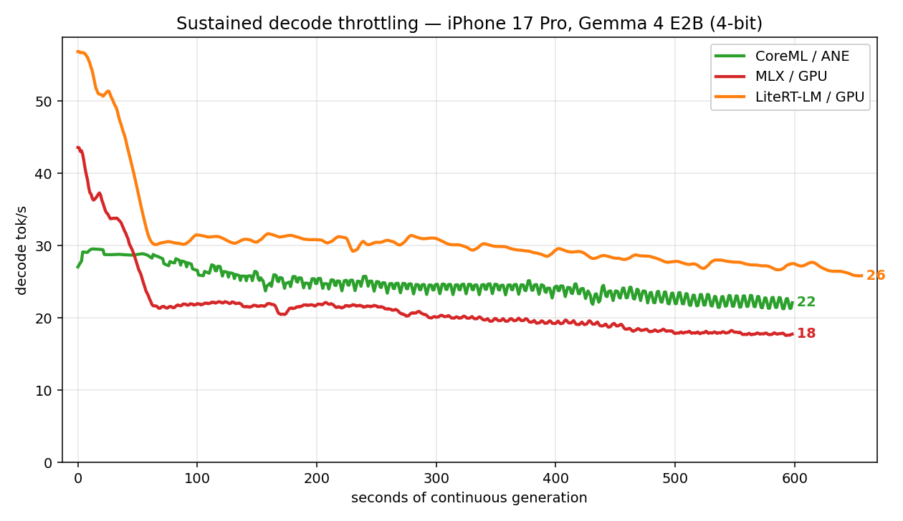

# Sustained load

The 10-minute table below is from June 2026: Debug builds on an older harness, and the LiteRT-LM run started at thermal state `fair`. This repo keeps those records as superseded. Newer 10-minute runs, from July 2026 and started at `nominal`, are in [`results/raw/2026-07-30-gemma4-e2b-protocol/`](../results/raw/2026-07-30-gemma4-e2b-protocol/README.md). In the first pair, LiteRT-LM fell from 57.1 tok/s to 35.4 and MLX's 4-bit PTQ build from 45.7 to 25.1 ([`scripts/throttle_curve.py`](../scripts/throttle_curve.py): mean of the first 5 samples against the last 10%). Don't compare those runs with this table.

Short runs measure **burst** speed. Run the same model **continuously** and it flips: the GPU runtimes (MLX, LiteRT-LM) heat up and shed **~50–60% of their throughput** under sustained load, while the **ANE barely moves** (retains ~65%). MLX crosses the 50%-lost line within ~60 s; LiteRT-LM is more thermally resilient early — it still holds ~53% of its burst rate at 1 min and only crosses 50% near the 4-min mark — but settles in the same place. The ANE draws ~half the package power (measured on Mac via `powermetrics` — iOS doesn't expose power counters to third-party apps), so it heats slowly and the SoC doesn't throttle it.



| Gemma 4 E2B, iPhone 17 Pro | Burst tok/s | Sustained (10 min) | Retained |
|---|---:|---:|---:|
| **CoreML / ANE** | 33 | **22** | **67%** |
| MLX / GPU | 48 | 18 | 38% |
| LiteRT-LM / GPU | 56 | 27 | 48% |

Two **independent** GPU runtimes collapsing the same way is a GPU-thermal property of the phone, not a runtime quirk. MLX ends up *below* the ANE; LiteRT keeps only a slim lead after shedding half its speed. **The GPU wins the sprint; the ANE wins the marathon** — and it frees the GPU for the rest of the app.

> Method: 600 s continuous generation, cold (`nominal`) start, unplugged, tg128; decode rate from a rolling window. Raw JSONL in `results/raw/superseded/2026-05-gemma-e2b-energy-tg128/`; redraw with [`scripts/throttle_chart.py`](../scripts/throttle_chart.py) (curves table via [`scripts/throttle_curve.py`](../scripts/throttle_curve.py)). LiteRT-LM has no output-token cap (longer per-call) and that run started at `fair` thermal; CoreML-LLM uses sliding-window attention (bounded context), part of why its decode stays flat.

## Live-camera VLM

The throttle section above is text decode. The next axis runs a **vision-language
model on the live camera, continuously for 10 minutes** — the workload an
always-on "point the phone at the world" feature actually is — and asks the same
question: **does the GPU melt while the ANE holds?**

Same phone, same scene, **Qwen3-VL 2B** on both paths (both run today):

- **GPU** — `MLXVLMRuntime` (MLX/Metal), `mlx-community/Qwen3-VL-2B-Instruct-4bit`.
- **ANE** — `CoreMLVLMRuntime` (CoreML, `.cpuAndNeuralEngine`) driving
  `john-rocky/CoreML-LLM`'s real Qwen3-VL pipeline (vision encoder → chunked
  INT8 decoder), model `mlboydaisuke/qwen3-vl-2b-coreml`.

The app gains a **Camera** tab: pick the backend, point it at a dense scene, hit
Start. The HUD overlays **sustained FPS, thermal state, battery, ANE residency**
live (it doubles as the screen-record surface for the demo clip). Each session
logs sustained FPS, per-inference TTFT, ANE residency (`MLComputePlan`), peak
thermal and whole-system power, plus the FPS-and-heat time series the chart is
drawn from:

```sh
# Camera tab → backend → 10 min → Start (run once per backend, same scene)
python3 scripts/vlm_throttle_chart.py     # → docs/charts/vlm-camera-throttle.png
```

Method, fairness rules, the ANE-residency measurement, and the clip protocol:
[`methodology/vlm-camera-ios.md`](../methodology/vlm-camera-ios.md). Numbers land
once the runs are captured on device — [a paired ANE/GPU session is a great PR](../CONTRIBUTING.md).
